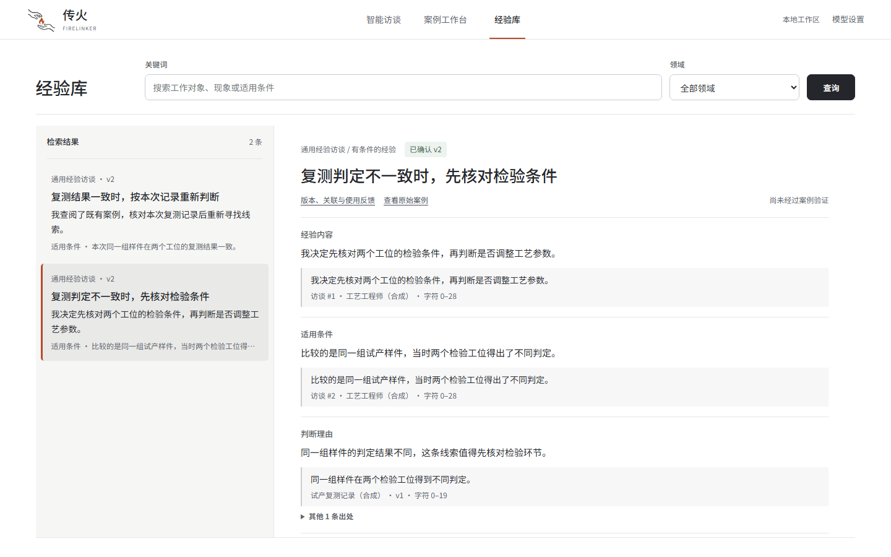
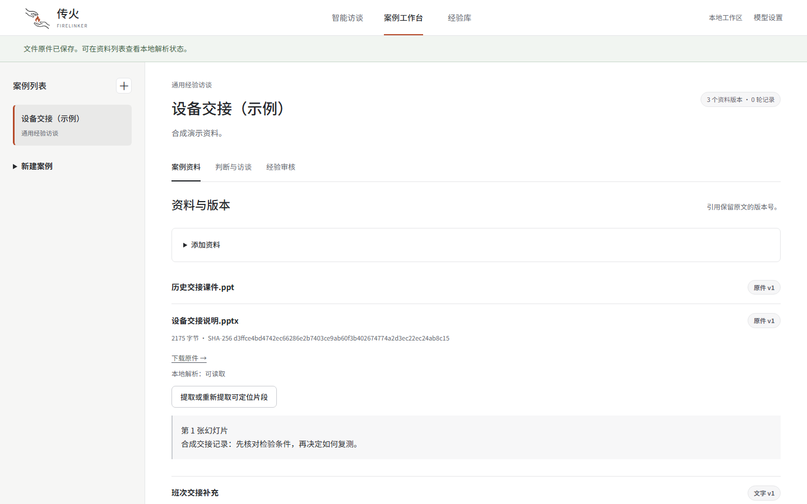

# 传火 Firelinker

**面向智能组织的开源经验传承框架**

遇到一次异常，老同事知道该先查哪里、哪些情况要换一种做法。过几个月，另一个班组可能遇到同样的现象，却找不到当时作出判断的依据。

传火用已有资料和 AI 访谈记录这些判断。它把当事人的原话、资料出处、适用条件和例外放在同一条经验里，经人工审核后供接手的人查阅。经验用过以后，可以记录结果和新发现，供下一次修订参考。

[快速开始](#快速开始) · [完整示例](#完整示例) · [工作台](#工作台) · [资料与文件](#资料与文件) · [应用场景](#应用场景) · [运行与贡献](#运行与贡献)



## 快速开始

| 启动方式 | 怎么开 |
| --- | --- |
| **Windows x64 便携包** | 如果从 GitHub 发行页下载的是 `Firelinker-Windows-x64-Portable-*.zip`，将整个 ZIP 解压到有写入权限的文件夹，双击 `start-firelinker.cmd`。包内自带 Python 和依赖，解压后可离线启动。 |
| **Windows 源码** | 安装 Python 3.11 或更新版本。克隆仓库或解压源码 ZIP，双击仓库根目录的 `start-firelinker.cmd`。首次启动需要联网安装依赖。 |
| **macOS / Linux 源码** | 安装 Python 3.11 或更新版本，在仓库目录运行 `python3 start_firelinker.py`。首次启动需要联网安装依赖。 |

启动后使用浏览器打开本地工作台。浏览器未自动打开时，访问终端显示的地址。使用期间保持启动窗口开着。首次启动时工作台为空，可以直接添加案例、记录资料或新建访谈。

### 用合成案例体验

以下命令适用于源码目录中的 Windows PowerShell。演示使用独立的 `.local-demo` 目录，导入设备排查和口述史两个示例，无需 API Key。

```powershell
python -m venv .venv
.\.venv\Scripts\python.exe -m pip install -c requirements-lock.txt -e ".[files]"
.\.venv\Scripts\python.exe -m experience_ledger demo --data-dir .local-demo
.\.venv\Scripts\python.exe -m experience_ledger serve --data-dir .local-demo --port 5057 --open-browser
```

macOS 和 Linux 使用 `python3 -m venv .venv`，后续命令用 `./.venv/bin/python`。如果 5057 端口已被占用，可以换一个端口。

在「案例工作台」打开示例，进入「经验审核」，对照出处核对一条候选经验。填写审核信息并确认后，即可在「经验库」检索。想体验 AI 追问时，在右上角的「模型设置」连接自己的模型服务。

## 完整示例

**把一次试产异常变成其他工厂能用的经验。** 以下案例和本文界面截图均使用合成资料。

1. **还原现场。** A 工厂试产时不合格率突然上升。生产团队准备调整工艺参数，资深工程师发现同一组样件在两个检验工位的判定结果不同，决定先核对检验条件。复盘人上传复测表和工艺变更记录，发起访谈。
2. **问清判断。** 访谈结合已有记录追问「哪条证据让你决定暂缓调参？」「如果两个工位的复测结果一致，你会如何判断？」工程师补充当时的观察、下一步行动和例外。
3. **对照出处审核。** 审核人核对复测记录和工程师原话，把经验中的适用条件写清楚，例如「同一组样件在不同工位得到不一致的检验结果」。确认后，同事可以在经验库查到这一版及其出处。
4. **记录使用结果。** B 工厂遇到相似的异常，但两个工位复测一致。工程师查到 A 工厂的经验，记录自己参考了哪一版、为何没有采用，以及本次看到的现象。后续修订可以把这种区别写进去，供下一次查阅。

## 工作台

| 入口 | 可以做什么 |
| --- | --- |
| **智能访谈** | 写下访谈目标，按需关联已有案例。智能体先查看目标和可用资料，再选择阅读、整理或提问。手头没有资料、只写了目标时，先提交一段原始叙述，再启动模型追问。 |
| **案例工作台** | 整理同一案例的资料、判断和访谈原话。对照引文和原件编辑候选经验，记录审核意见。 |
| **经验库** | 按关键词和领域查找已确认经验，查看适用条件、例外、出处和历史修订。可以比较相同、互补或有分歧的经验，为关联建议记录人工核对结果，也能为实际参考过的版本记录使用反馈。 |
| **模型设置** | 连接、测试和保存自己的模型服务。日常录入、人工审核、查阅和演示可以独立使用。 |

已确认经验出现待审核修订时，经验库继续提供原确认版并标明新修订状态。新修订确认后会成为默认版。需要停止供人参考时，可人工撤下确认版，历史记录仍可查阅。

## 资料与文件

在「案例工作台」进入「案例资料 → 添加资料」，选择「上传文件」或「记录文字」。两种资料都在同一列表里，也都可以保留版本。展开一项资料，可以看文字原文，或下载文件原件并查看已有的提取片段。引用关联到实际使用的资料版本。



| 可上传的原件 | 本地读取内容 |
| --- | --- |
| TXT、Markdown | UTF-8 文字 |
| PDF | 按页提取文本。扫描件中的文字需要另行识别。 |
| DOCX | 文字段落和表格单元格 |
| XLSX | 单元格值和公式原文 |
| **PPTX** | 按幻灯片顺序提取正文和表格文字，可引用具体幻灯片。图形、备注和版式以原件为准。 |
| PNG、JPEG、WebP | 图片尺寸。图片内容可交给支持图片输入的模型读取。 |
| 旧版 DOC、XLS、**PPT** | 保存原件和版本。需要在本地提取文字时，可先另存为新版格式或合适的 PDF。 |

原件单个上限为 25 MiB。可上传的格式、程序能在本地提取的内容、模型服务可接收的原件格式由不同环节决定。详细的范围和人工核对方式见 [文件输入与引用说明](docs/file-inputs.md)。

## 模型设置

打开「模型设置」，填写服务商、API 地址和模型名称。服务需要认证时，填写自己的 API Key，测试连接后保存。传火使用你配置的模型服务，开源仓库和便携包均包含工作台与访谈框架。

- 使用 **Chat Completions** 接口时，访谈可以读取用户记录的文字和本地提取的片段。
- 使用 **Responses** 接口时，可声明你已确认该服务和模型支持的原件格式，按需向模型发送原件，包括端点实际支持的演示文稿或图片。

连接测试用合成文本检查访问和结构化返回。要验证模型是否能读某个格式，可以用可分享的样例实际试读。具体设置见 [文件输入与模型能力](docs/file-inputs.md) 和 [环境变量示例](.env.example)。

## 应用场景

可以从一次判断难、材料散、以后还会遇到的事件开始。下面是一些试点选题。[查看分行业应用场景指南](docs/applications.md)，内含 **31 个场景**的起步材料、访谈问题和使用方式。

| 领域 | 可以从哪个事件开始 | 留下什么判断，给谁用 |
| --- | --- | --- |
| **制造与设备运维** | 试产时同组样件在两个工位的判定不同，或换班后同一设备反复报警。 | 留下改变排查顺序的观察和排除过的原因，供质量工程师和后续班组对照。 |
| **能源与工程建筑** | 屋面光伏项目的现场条件与设计版本有出入，或施工交叉作业导致返工。 | 留下哪项约束改变了方案，以及应该在哪一步复核，供设计、报价和项目交付人员使用。 |
| **采购、仓储与物流** | 相同供应商的不同批次发生异常，或货物在交接中出现数量差异。 | 留下扩大批次追溯或定位交接环节的依据，供采购、仓库和配送团队回查。 |
| **零售、电商与售前** | 同场促销在两家门店出现缺货与积压，或项目因交付范围有分歧而停滞。 | 保存门店之间的客流和补货条件，或导致需求误读的原话，供经营和售前团队对照。 |
| **软件运维与数据分析** | 新版本只影响部分用户，或两份经营报表给出不同结果。 | 保存定位范围、决定回退或调整统计口径的证据，供值班人员和分析师参考。 |
| **客服与专业项目交付** | 工单经多次转交仍未解决，或项目评审后客户改变方向。 | 留下哪句原话暴露了需求差异、什么时候应升级或确认，供接手人员复用。 |
| **岗位交接与新人带教** | 资深员工即将转岗，或新人面对同样现象总作出相同误判。 | 保存容易被忽略的线索和例外。接班人可按问题查找，导师可挑相似案例对照训练。 |
| **教学与课程改进** | 两个班级在同一个任务中出现相似错误。 | 保留促使教师改变讲授顺序的作业样例和判断依据，供教研团队在其他班级复核。 |
| **科研仪器与实验室** | 共享显微镜更换相机后出现图像差异，或实验室交接时发现不同批次的结果难以比较。 | 保存复测条件、设备配置和判断依据，供平台管理员排查、新人上机带教和课题组复核历史数据。 |
| **政务、医疗运营与公益** | 申请多次退回、病区物资交接中断，或志愿服务点的需求临时变更。 | 留下哪个环节需要补材料、当面核对或跨部门确认，用于交接培训和事后复盘。 |
| **农业、食品与传统技艺** | 相邻地块、不同生产批次或不同工匠的样件出现差异。 | 保存从外观、时间和工序上观察到的线索，供下一季生产、批次复查或实操带教。 |
| **编辑出版、博物馆与口述史** | 同一段内容被不同受众误读，或同一事件有多种来源和说法。 | 留下改稿取舍、出处差异和仍待核对的内容，供编辑、策展人和研究者继续核查。 |

## 运行与贡献

当前版本是本地单用户工作台，默认数据目录为 `.local-data`。保存的 API Key 以本机明文文件留在数据目录中。调用 AI 时，相关访谈内容或所选资料会按配置发送给模型服务。案例导出和完整备份见 [存储与备份](docs/architecture.md#检索导出与备份)。

[实现与访谈智能体](docs/interview-agent.md) · [领域扩展](docs/domain-extension.md) · [当前版本范围](PROJECT_STATE.md) · [参与开发与测试](CONTRIBUTING.md) · [MIT 许可证](LICENSE)
